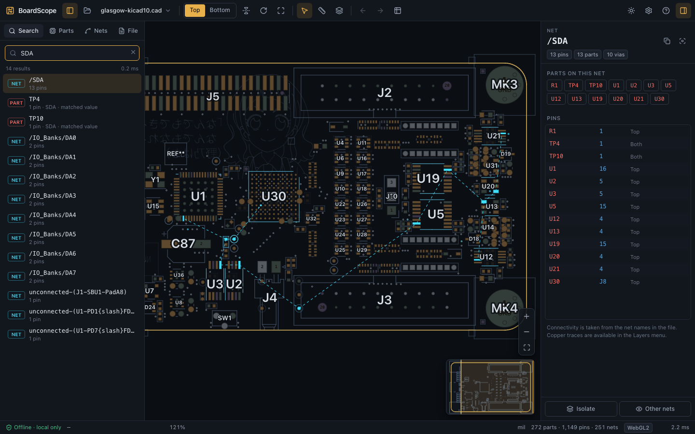
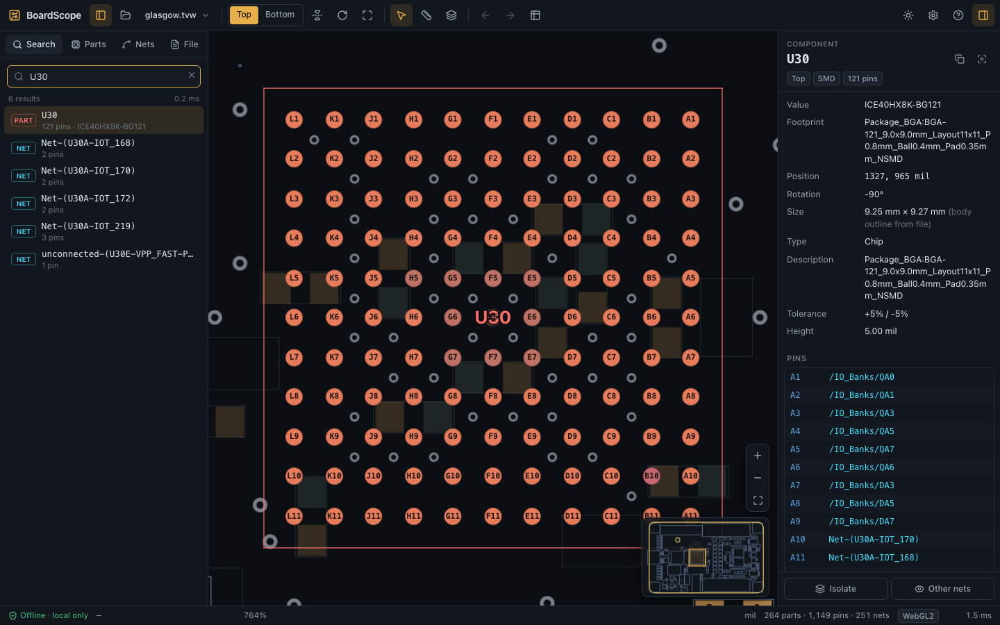
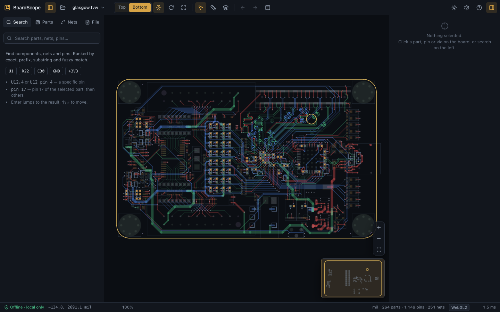
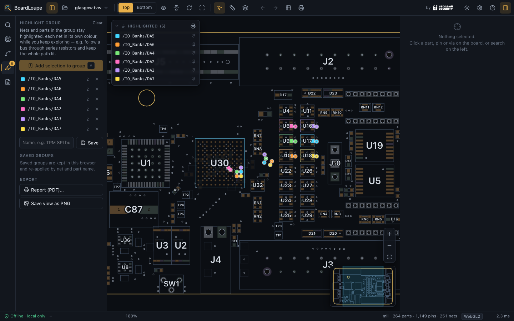
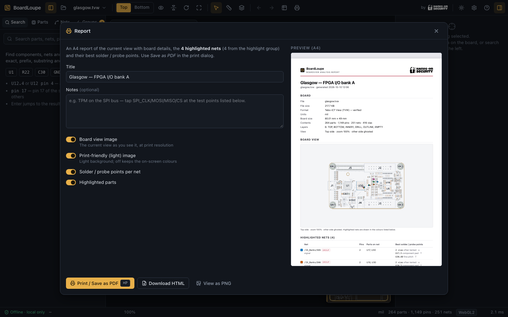

# BoardScope

**An offline, private boardview viewer in a single HTML file.**
Open `dist/boardview.html` by double-clicking it. It runs in Chrome, Edge,
Firefox and Safari with no installation, no server, no network access and no
account. Boardview files are parsed in your browser and never leave your machine.

A [**Hands-On Security**](https://hos.direct/boardscope) tool — built for the hardware
security classroom: identify components, trace a bus across the board, and find better,
more accessible solder and probe points on the same net (for example reaching the SPI/LPC
bus of a TPM at a test point or a resistor terminal instead of on a fine-pitch ball).



| | |
|---|---|
|  |  |
|  |  |

## Quick start

1. Get `dist/boardview.html` (≈2.0 MB, ≈839 KB gzipped). It is the only file you need.
   Most of the size is the RAR/7z decoder, which is decoded and run only the first
   time you open a RAR or 7z — nothing is fetched, ever.
2. Double-click it, or drag it into a browser window.
3. Drop a boardview file onto the page, click **Browse files…**, or press <kbd>Ctrl/⌘</kbd>+<kbd>O</kbd>.
   ZIP, RAR and 7z archives work too, as do multi-file ASC sets (select all files or drop the folder).

Build it yourself:

```bash
npm ci
```

```bash
npm run build
```

## Supported formats

Formats are recognised **by content**, not by file extension. The full details
(signatures, fixtures, limitations) are in [FORMAT_MATRIX.md](FORMAT_MATRIX.md).

| Format | Status | Tested with |
|---|---|---|
| Tebo-ICT View `.tvw` (standard header, Gigabyte variant) | verified | reference-validated synthetic board with traces, drills, arcs and decal outlines; also checked locally on real Lenovo and Gigabyte boards |
| BRD Test_Link (plain, obfuscated, Lenovo variant) `.brd` `.bv` | verified | reference-validated synthetic |
| BRD2 / BRDOUT (Toptest, kicad-boardview) `.brd` | verified | **real** file |
| BDV `.bdv` | verified | reference-validated synthetic |
| BVR `BVRAW_FORMAT_1` `.bvr` | verified | reference-validated synthetic |
| BVR3 `BVRAW_FORMAT_3` `.bvr` | verified | **real** file |
| FZ (zlib; RC6-encrypted with **your** key) `.fz` | verified | synthetic test key; two real encrypted boards opened locally with a private keyfile |
| GenCAD 1.4 `.cad` `.gcd` | verified | **real** KiCad 10 exports; checked locally on real CAMCAD exports |
| KiCad PCB `.kicad_pcb` (KiCad 5–10) | verified | **real** KiCad board, checked pin by pin against KiCad's own export |
| Mentor Graphics neutral file `.neu`, CAD "###Panel Added" `.cad` | verified | reference-validated synthetic; checked locally on real neutral files |
| Fabmaster FATF and FARC (`.faz` job ZIPs) | verified | synthetic boards in both encodings; checked locally on real Gigabyte jobs against their own absolute pin data |
| GenCAM (IPC-2511) `.a3p` | verified | synthetic; checked locally on a real Compal board |
| Unisoft F2B `.f2b` | verified | synthetic; checked locally on two real boards |
| BV database (Microsoft Access / Jet) `.bv` | verified | synthetic Jet 4 database; checked locally on real Apple boards |
| **Cadence Allegro `.brd` (15.x–17.x), read natively** | partial | synthetic 16.6/17.2; real 15.5 matched against its GenCAD export (1,945 parts, all 8,468 pin nets; 99.1% pad centres within 0.05 mil); three real 16/17 boards checked against KiCad 10 |
| ASC multi-file set `.asc` (incl. VayoPro-Test Expert / TSICT exports) | partial | reference-validated synthetic; checked locally on a real set |
| CAE (FZ container, needs key) `.cae` | partial | synthetic test key; two real encrypted boards opened locally with file outlines and component bodies |
| TopTest numbered-section BRD (+ `.con`) | experimental | documented layout; no authentic file found (corpus + web, 2026-10) |
| Allegro Extracta text (`A!`/`S!` rows) | experimental | documented layout; no authentic export found (generated on demand, none published) |
| NBV (NexusBV export) `.nbv` | experimental | documented wire order; no `.nbv` sample found (corpus + public code search) |
| CST `.cst` | experimental | reference-validated synthetic |
| XZZ PCB `.pcb` (needs key for components) | partial | synthetic test key; two real encrypted boards opened locally; 16-layer routing checked on the RedmiBook sample |
| ZIP, RAR and 7z containers | supported | ZIP (pure JS); RAR4/RAR5 and 7z via bundled libarchive WebAssembly — real board in a 7z, upstream compressed RAR5 fixture (CI), real RAR4 archives (local) |

"Verified" means the parser's output equals the output of the original
open-source reference implementation (OpenBoardView / eagleview, compiled from
source) on the fixture, plus integrity, fuzz and browser tests.
**No vendor decryption keys are included.** Encrypted FZ, CAE and XZZ files show a clear
"key required" message. BoardScope is a **bring-your-own-key** tool for keys you are
entitled to use — see [Decryption keys](#decryption-keys-bring-your-own) below.

### Decryption keys (bring your own)

Some FZ, CAE and XZZ files are encrypted. BoardScope ships no keys and is fully functional
without them; to open such a file you supply the key yourself under **Settings → Decryption keys**.

- **Per format.** A key can be set for FZ, CAE and XZZ independently. The panel shows which
  formats currently have a key — never the key material itself.
- **Import a keyfile.** Paste a key, or import a keyfile you created that holds several keys at once.
  For local research notes in `*.key.md`, `python3 tools/merge-research-keys.py /path/to/docs/formats private-keys/boardscope.keys.json`
  creates an ignored keyfile with FZ, CAE and XZZ keys and the accompanying note metadata. Import it
  under Settings. For repeatable local checks, set `BS_RESEARCH` to the corpus directory and
  `BS_RESEARCH_KEYFILE` to that ignored keyfile, then run `npm test` or `npm run test:e2e`.
- **Remember, encrypted.** Optionally save your keys in this browser, encrypted at rest with a
  passphrase (AES-GCM-256 via PBKDF2-SHA-256, 310 000 iterations). The passphrase is never stored;
  you re-enter it to **unlock** on a later visit. You can **replace** or **remove** the saved keys
  at any time. Without saving, keys live in memory only for the session.
- **Never leaks.** Key material stays out of the saved file, logs, reports, screenshots, exports and
  error messages. Entering or unlocking a key re-opens the file you were trying to view.

### Allegro boards, natively

Cadence Allegro `.brd` databases (releases 15.5, 16.x and 17.x) open directly: no Allegro, no KiCad, no
conversion. BoardScope walks Allegro's record stream itself and builds parts, pins, nets, drills,
vias, copper traces, the board outline and the copper layer names. On real boards this matches
KiCad 10's own Allegro import pin for pin for 16.x/17.x; a matching GenCAD export validates 15.5
pins and nets (see FORMAT_MATRIX.md). Other 15.x variants have not been tested. Altium,
PADS and Eagle designs can still be opened through a KiCad import (KiCad PCB is supported).

## Using the viewer

- **Navigate.** Scroll or pinch to zoom at the cursor. Drag to pan; a quick release glides. Double-click to zoom in.
  Arrow keys pan. <kbd>F</kbd> fits the board, <kbd>Z</kbd> focuses the selection, <kbd>+</kbd>/<kbd>−</kbd> zoom.
  The minimap (bottom right) shows the viewport; click or drag it to move.
- **Sides.** **Top/Bottom** in the toolbar, or <kbd>Space</kbd>. The bottom view is mirrored like a
  board turned over (turn this off in *Layers & display*). Components on the other side are ghosted,
  hidden or shown; the eye button next to Top/Bottom (or <kbd>G</kbd>) switches to **only this side**.
  Highlights follow the same rule, so a selected net never shows through a hidden side. <kbd>X</kbd> mirrors and <kbd>R</kbd> rotates by 90°. Picking and labels stay
  correct in every orientation.
- **Search** (<kbd>/</kbd> or <kbd>Ctrl/⌘</kbd>+<kbd>K</kbd>). Results are ranked exact, then prefix, then substring, then fuzzy, across
  parts, nets and values. Examples: `U42`, `R101`, `GND`, `+3V3`, `USB_D+`, `U12.4`, `U12 pin 4`, and
  `pin 17` (pin 17 of the selected part first). <kbd>↑</kbd>/<kbd>↓</kbd> move, <kbd>Enter</kbd> jumps.
- **Highlighting that reads at any zoom.** A selected net, pin or component is drawn as a bright
  **beacon** — a haloed pad with a minimum on-screen size — so it stays visible even when the pad
  itself is sub-pixel on a zoomed-out board. Everything else recedes so the selection stands out.
- **Trace a bus.** <kbd>Shift</kbd>-click (or add from *Nets*) several nets to build a multi-net
  selection; each net gets its own high-contrast colour, so you can follow an SPI / LPC / eSPI bus
  across the board at a glance. <kbd>I</kbd> isolates the selection and <kbd>H</kbd> hides other nets.
- **Find a solder / probe point.** The inspector ranks every physical point on a net by how practical
  it is to tap a wire onto — **test points first, then through-holes, connectors and large pads, with
  fine-pitch IC pads last** — each with its board side. Click one to jump straight to it. This is the
  classroom workflow for reaching a bus somewhere accessible instead of on a BGA ball.
- **Highlight groups.** Press <kbd>A</kbd> (or *Group* in the inspector) to add the selection to the
  highlight group. Its nets stay lit, each in its own colour, while you keep exploring — e.g. follow a bus
  through its series resistors and keep the whole path highlighted. A legend on the board names every
  colour. Groups can be saved by name in the *Groups* tab (kept in this browser only) and re-applied later,
  matched by net and part name, so they also work on another revision of the board.
- **Report (PDF) and image export** (<kbd>Ctrl/⌘</kbd>+<kbd>P</kbd>). An A4-portrait report with header,
  footer and logos: file and board details, the current view (optionally rendered print-friendly in
  light colours), every highlighted net with its colour, parts and best solder / probe points, the
  highlighted parts, and your notes. *Print / Save as PDF* turns it into a PDF; *Download HTML* saves the
  self-contained report. *Save view as PNG* exports the view with a legend of the highlighted nets. Reports
  are generated offline, contain no scripts, and escape all text taken from the file.
- **Inspect.** Click a part to see refdes, side, mount, position, rotation, footprint, value,
  attributes, its pin table with nets, and parts it connects to on signal nets. Click a pin to see its
  part, number, name, net and pad, and to highlight its net. Click a net (in the inspector, search or
  *Nets*) to highlight all its pins and parts and fit the view to it.
  <kbd>Alt</kbd>+<kbd>←</kbd>/<kbd>→</kbd> step through the selection history. <kbd>Esc</kbd> clears.
- **Layers & display** (<kbd>L</kbd>). Toggle outline, bodies, pins, vias, real copper traces (when the
  file has them, per layer), labels, net colouring, and **air wires**. Air wires are dashed, inferred
  straight connections between a net's pins; they are never real traces.
- **Measure** (<kbd>M</kbd>). Click two points; clicks snap to pin and via centres. Distances are shown in mm and in
  the file's unit. If a format does not define its unit, the unit is marked "assumed"; unknown units
  are shown as raw units.
- **Tables & export** (<kbd>T</kbd>). Sortable, filterable tables of parts, nets and pins, with copy and
  jump-to. Export the filtered table as CSV, or the whole normalized model as JSON.
- **File info** (*File* tab). Detected format, support status, detection confidence, units, counts,
  capabilities, every parser diagnostic, and load timings.

What you see is what the file contains. Drilled pads show their real drill as a hole; holes are
drawn above all copper, so overlapping pads never hide one. Outlines of mechanical parts (mounting
holes, fiducials) are keep-outs and are drawn dashed. When a file lacks pad sizes, pads are sized
from pin spacing (the inspector says so). When it lacks an outline, a dashed bounding rectangle is shown.
Unavailable fields are labelled "not in file".

## Privacy

- Files are read with the File API and parsed in a Web Worker created from a Blob URL. Nothing is uploaded.
- The page makes **no network requests**: no CDN, fonts, analytics, telemetry or error reporting.
  The build fails if the HTML references any external resource, and the end-to-end tests assert that
  zero requests are made.
- `localStorage` holds display preferences only (`boardscope.prefs.v1`). Decryption keys are stored
  only if you save them, and then only as a passphrase-encrypted blob (`boardscope.keystore.v1`,
  AES-GCM/PBKDF2); the passphrase and the plaintext keys are never written. Board contents are never stored.

## Architecture

```
File(s) ─► worker (Blob URL)                              main thread
           ├─ registry: detect by content → candidates     ├─ Viewer (imperative): camera, picking, hover
           ├─ parser (formats/*.ts) → BoardBuilder         ├─ WebGL2 renderer (instanced SDF pads, AA segments)
           │    └─ normalized BoardModel (typed arrays)    │    └─ Canvas2D fallback renderer
           ├─ validateModel (referential integrity)        ├─ Canvas2D overlay: labels, measure
           └─ buildScene: pad sizes, bodies, R-trees   ───► └─ Preact UI: toolbar, explorer, inspector, tables
```

- `src/formats/`: one module per format, each with `detect()` (confidence + reason) and `parse()`.
  The registry ranks candidates, falls back when a parser rejects a file, expands ZIPs, and produces
  precise diagnostics.
- `src/io/`: bounds-checked `ByteReader`, text decoding (UTF-8 / Windows-1252 / UTF-16), line splitting
  that reproduces the reference, size-capped inflate (decompression-bomb protection), and DES.
- `src/model/`: versioned struct-of-arrays model (`boardscope/board@1`) for parts, pins, nets, vias,
  traces, outline, units, capabilities and diagnostics. The builder groups pins by part, builds net
  membership, derives boxes and outlines (flagged as derived), and validates integrity.
- `src/scene/`: render-ready derived data plus flatbush R-trees, built in the worker and transferred zero-copy.
- `src/render/`: camera (world ↔ screen with side mirroring and 90° rotations, unit-tested),
  WebGL2 renderer, Canvas2D fallback, labels, picking, colour styles.
- `src/app/`: store, actions, Preact components. Pan and zoom never re-render the component tree.
- `tools/postbuild.mjs`: inlines the JS and CSS, embeds licence notices, and fails the build on any
  external reference or a size-budget overrun (1.5 MB).

Safety: no `eval`, `new Function` or dynamic code (enforced by lint). File contents are never inserted
as HTML. All binary reads are bounds-checked, counts are sanity-checked against the remaining bytes,
decompression output is capped, and input size is capped at 400 MB.

## Development

| Command | What it does |
|---|---|
| `npm run dev` | Vite dev server with hot reload |
| `npm run build` | Builds `dist/boardview.html` and verifies it is self-contained |
| `npm test` | All unit, format, differential and fuzz tests (Vitest) |
| `npm run test:formats` | Format tests only |
| `BS_PRIVATE_FIXTURES=/dir npm test` | Also runs integrity and geometry checks on your own (non-redistributable) boardviews in `/dir` |
| `BS_RESEARCH=/dir npm test` | Also opens every sample of a research corpus (`fixtures/manifest.jsonl`) and checks Fabmaster placement against the job's absolute pin data |
| `npm run test:e2e` | Playwright on the built file over `file://` (Chromium, Firefox, WebKit). Run `npm run build` first. |
| `npm run lint` / `npm run typecheck` | ESLint / TypeScript |
| `npm run fixtures` | Regenerate synthetic fixtures from the real Glasgow board |
| `npm run goldens` | Rebuild reference outputs with the OpenBoardView/eagleview C++ harness (needs a C++17 compiler and zlib; fetches the pinned sources) |
| `npm run bench` | Node parse/index/search benchmark (1k–200k pins); writes `bench/results-node.json` |
| `npx tsx tools/bench-browser.ts chromium --gpu` | In-browser load and frame-time benchmark on the built file |

Adding a format: create `src/formats/<name>.ts` that exports a `FormatModule`, register it in
`registry.ts`, add a fixture and a manifest entry, and (if a reference exists) a golden. The
differential, fuzz, detection and end-to-end suites pick it up automatically.

## Performance

Synthetic laptop-like boards (BGAs, QFNs, connectors, passives; locality-heavy nets).

Node 26 (single thread, Apple M3 Pro), from `bench/results-node.json`:

| Pins | Parts | Nets | Parse (BRD2 / TVW) | Index | Search query (avg) |
|---|---|---|---|---|---|
| 10k | 527 | 2,040 | 23 / 27 ms | 8–17 ms | 0.3 ms |
| 50k | 2,973 | 10,296 | 75 / 94 ms | 30 ms | 1.1 ms |
| 100k | 6,300 | 20,618 | 124 / 129 ms | 42–51 ms | 2.3 ms |
| 200k | 13,307 | 41,174 | 238 / 238 ms | 77–95 ms | 4.7 ms |

Chromium (Metal GPU, Apple M3 Pro, 2× DPR, 1440×900 window), continuous zoom and pan for 240 frames
on the built file, from `bench/results-chromium-gpu.json`:

| Board | Load (file → ready, in worker) | Avg frame | p95 frame | CPU per frame |
|---|---|---|---|---|
| 10k pins (BRD2) | 63 ms | 16.9 ms | 18.6 ms | 2.2 ms |
| 50k pins (TVW) | 116 ms | 16.7 ms | 18.1 ms | 1.8 ms |
| 100k pins (BRD2) | 186 ms | 16.7 ms | 18.3 ms | 0.9 ms |
| 200k pins (TVW) | 371 ms | 16.7 ms | 18.4 ms | 1.0 ms |

Same benchmark in the other engines (`bench/results-webkit.json`, `bench/results-firefox.json`):

| Board | WebKit 27.2 (Apple GPU): load / avg / p95 frame | Firefox 157 (GPU): load / avg / p95 frame |
|---|---|---|
| 10k pins | 99 ms / 16.6 / 19 ms | 121 ms / 8.4 / 11 ms |
| 50k pins | 137 ms / 16.6 / 19 ms | 154 ms / 9.6 / 17 ms |
| 100k pins | 166 ms / 16.7 / 19 ms | 201 ms / 9.5 / 16 ms |
| 200k pins | 379 ms / 16.6 / 19 ms | 406 ms / 9.1 / 14 ms |

Frame intervals equal the 60 Hz display refresh: rendering never drops below 60 FPS on this machine.
(Headless Firefox does not throttle animation frames to the display, hence intervals below 16.7 ms.)
Software-only WebGL (e.g. headless SwiftShader) is far slower on 200k-pin boards. In that case use
*Settings → Force Canvas 2D*, which culls with the R-tree.

## Limitations

- Vendor boardviews are not committed. Synthetic fixtures run in CI; the optional local corpus
  exercises real files, including encrypted FZ, CAE and XZZ when a separate keyfile is supplied.
- Encrypted FZ, CAE and XZZ need user-supplied keys.
- Part body outlines are drawn when the file provides them (TVW decals, GenCAD shapes); otherwise
  boxes around the pins are shown. BVR3 relative outlines are not drawn.
- Copper pours (TVW surfaces) and GenCAD artwork are not drawn. Net-associated traces are shown for
  formats that store them, including TVW, GenCAD, Allegro, Fabmaster and XZZ PCB.
- Comparison mode (two boards side by side) is not implemented. Recent files are kept per session only.
- Altium ASCII, IPC-D-356, `.bvr2` and FlexBV-specific formats are not supported (see FORMAT_MATRIX.md).

## Troubleshooting

- **"No supported boardview signature"**: the file is not one of the supported dialects. The message
  shows the first bytes and whether the content looks encrypted or compressed. Extensions such as
  `.brd` are shared by incompatible formats.
- **Dropped a whole board folder**: BoardScope opens the boardview in it (also inside ZIP, RAR and 7z,
  one level of ZIP-in-ZIP, ignoring macOS metadata). If there is none, it lists what the files are —
  schematics, PDF boardview drawings, BIOS/EC firmware dumps, programs — so you know what is missing.
- **Password-protected RAR/7z**: BoardScope does not prompt for archive passwords. Extract the archive
  with its password first, then open the boardview inside.
- **"Key required" / "parity check"**: the file is encrypted. Set a key you are entitled to use under
  *Settings → Decryption keys* (see [Decryption keys](#decryption-keys-bring-your-own)).
- **ASC needs all files**: select `format.asc`, `pins.asc` and `nails.asc` together, or drop the folder or a ZIP.
- **Blank or slow canvas**: your browser may have WebGL2 disabled or software-only. Enable
  *Settings → Force Canvas 2D renderer*.
- **Nothing happens on open in a very old browser**: the minimum targets are Chrome/Edge 111,
  Firefox 115 and Safari 16.4.

## Credits and licences

BoardScope is published by [Hands-On Security](https://hos.direct/boardscope) and is MIT-licensed.
The bundled archive decoder retains its own third-party licences, including OpenSSL 1.0.2s.
This product includes software developed by the OpenSSL Project for use in the OpenSSL Toolkit (http://www.openssl.org/).
This product includes cryptographic software written by Eric Young (eay@cryptsoft.com).
The KiCad reader follows KiCad's public file-format documentation. The parsers are re-implementations informed by
[OpenBoardView](https://github.com/OpenBoardView/OpenBoardView) (MIT) and
[eagleview](https://github.com/nitrocaster/eagleview) by Pavel Kovalenko (MIT, TVW). Real fixtures
come from [kicad-boardview](https://github.com/whitequark/kicad-boardview) (0BSD, Glasgow board).
See [THIRD_PARTY_NOTICES.md](THIRD_PARTY_NOTICES.md), [LICENSES/](LICENSES) and
[fixtures/PROVENANCE.md](fixtures/PROVENANCE.md).
